# Manual de Usuario: SISLAB

SISLAB, Sistema de Laboratorios, organiza los grupos de las prácticas de laboratorio de la Universidad de Sonora y las solicitudes de preparación de reactivos, equipo y manejo de residuos.

Este manual describe lo que ve cada persona usuaria en la pantalla, paso a paso. Las capturas provienen de un entorno de prueba con datos ficticios. Los nombres, correos y fechas no corresponden a personas reales, aunque la interfaz sí muestra los catálogos reales de laboratorios, carreras, materias y prácticas.

SISLAB tiene tres roles: profesor, personal de laboratorio y administración. Una persona puede tener varios roles. La sección de cada rol explica sus pantallas y sus acciones.

## Índice

1. [Autenticación](#autenticación)
   - [Ingresar](#ingresar)
   - [Crear una cuenta](#crear-una-cuenta)
   - [Recuperar la contraseña](#recuperar-la-contraseña)
   - [Cuando ya tienes una sesión activa](#cuando-ya-tienes-una-sesión-activa)
2. [Flujos de uso: profesores](#flujos-de-uso-profesores)
   - [Tablero](#tablero)
   - [Creación de grupos](#creación-de-grupos)
   - [Creación de solicitudes](#creación-de-solicitudes)
3. [Flujos de uso: personal de laboratorio](#flujos-de-uso-personal-de-laboratorio)
   - [Solicitudes](#solicitudes)
4. [Flujos de uso: administradores](#flujos-de-uso-administradores)
   - [Administración de usuarios](#administración-de-usuarios)
   - [Prácticas de laboratorio](#prácticas-de-laboratorio)
   - [Períodos](#períodos)
   - [Catálogos](#catálogos)
   - [Configuración](#configuración)

## Autenticación

### Ingresar

Abre SISLAB en el navegador y selecciona **Ingresar** en la barra superior. La pestaña **Ingresar** de la tarjeta de acceso pide tu correo electrónico y tu contraseña.

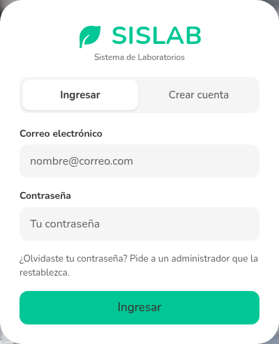

Escribe los dos datos y pulsa **Ingresar**. Si el correo o la contraseña no coinciden, SISLAB muestra el mensaje "El correo o la contraseña no son correctos." y no indica cuál de los dos datos falló.

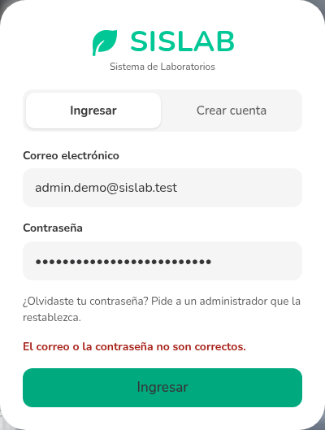

Al ingresar correctamente, SISLAB te lleva al Tablero que corresponde a tus roles.

### Crear una cuenta

Una cuenta nueva no entra en uso de inmediato. Primero solicitas acceso y después una persona administradora verifica tu identidad fuera de SISLAB y activa tu cuenta.

1. Abre la pestaña **Crear cuenta** de la tarjeta de acceso.

   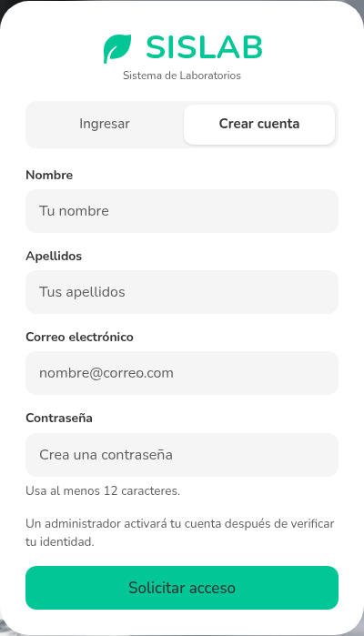

2. Escribe tu nombre, tus apellidos, tu correo electrónico y una contraseña de al menos 12 caracteres.
3. Pulsa **Solicitar acceso**.

Cuando el envío termina, SISLAB muestra el aviso "Recibimos tu solicitud. Una persona administradora debe verificar tu identidad y activar tu cuenta antes de que puedas ingresar."

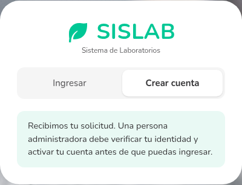

Cuando la administración active tu cuenta, ingresa con el correo y la contraseña que elegiste. Si intentas ingresar antes de la activación, verás el mismo mensaje que con una contraseña incorrecta.

### Recuperar la contraseña

SISLAB no envía correos para restablecer la contraseña en esta versión. Para recuperarla, comunícate con una persona administradora por un medio que ya uses con ella. La tarjeta de acceso lo indica debajo del campo de contraseña.

La persona administradora escribe una contraseña nueva en la sección **Usuarios** y te la comparte. El paso a paso para la administración está en [Restablecer contraseña](#restablecer-contraseña). Al cambiar la contraseña, SISLAB cierra las sesiones que tu cuenta tuviera abiertas en otros dispositivos.

### Cuando ya tienes una sesión activa

Si ya ingresaste, SISLAB reconoce tu sesión en la tarjeta de acceso. No necesitas volver a ingresar.

- Si abres la página de ingreso, SISLAB te lleva directamente a tu Tablero.
- Si abres **Crear cuenta** o la página de inicio, la tarjeta muestra **Sesión activa**, tu nombre y el botón **Ir a mi espacio**.

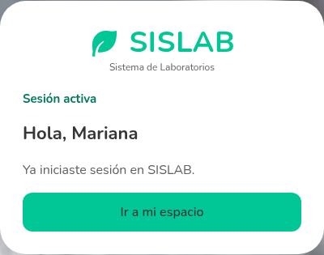

Para salir de tu cuenta usa **Cerrar sesión** al final del menú lateral.

## Flujos de uso: profesores

Un profesor registra sus grupos en cada período académico y pide preparación para las prácticas de esos grupos. Los profesores solo ven sus propios grupos y solicitudes.

### Tablero

El Tablero es la primera pantalla después de ingresar. Muestra el día de hoy, el período académico actual y dos bloques.

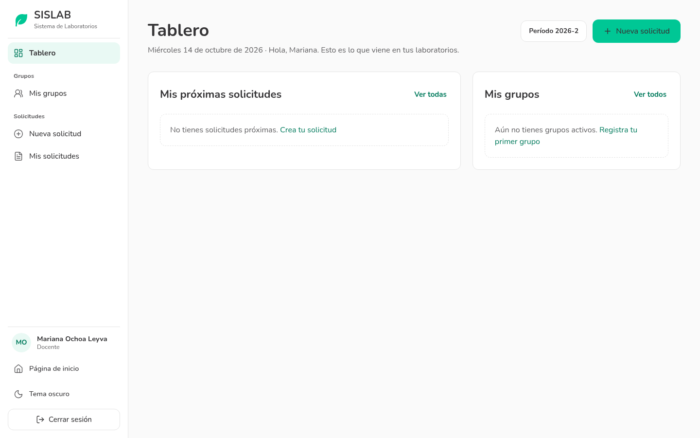

- **Mis próximas solicitudes** enumera hasta cuatro solicitudes con fecha de hoy o posterior. Cada fila muestra la fecha, la hora, la práctica, el grupo, el laboratorio y el estado. Un clic lleva a la lista completa con **Ver todas**.
- **Mis grupos** enumera tus grupos activos con su día, horario y laboratorio. Un clic lleva a **Mis grupos**.
- El botón **Nueva solicitud** abre el formulario para pedir una preparación.

Cuando tienes grupos y solicitudes, el Tablero se ve así:

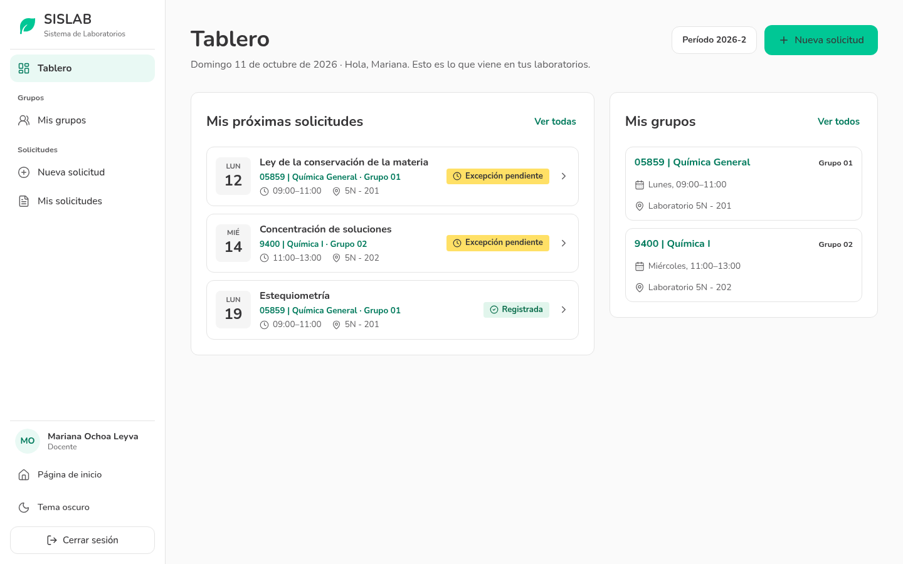

Si todavía no tienes grupos, el bloque **Mis grupos** te invita a registrar el primero. Si no tienes solicitudes próximas, el bloque **Mis solicitudes próximas** te invita a crear una.

### Creación de grupos

Registra un grupo en **Mis grupos**, en la sección **Grupos** del menú lateral. El botón **Nuevo grupo** abre el formulario **Registrar grupo**. También puedes llegar desde el Tablero con el enlace **Registra tu primer grupo**.

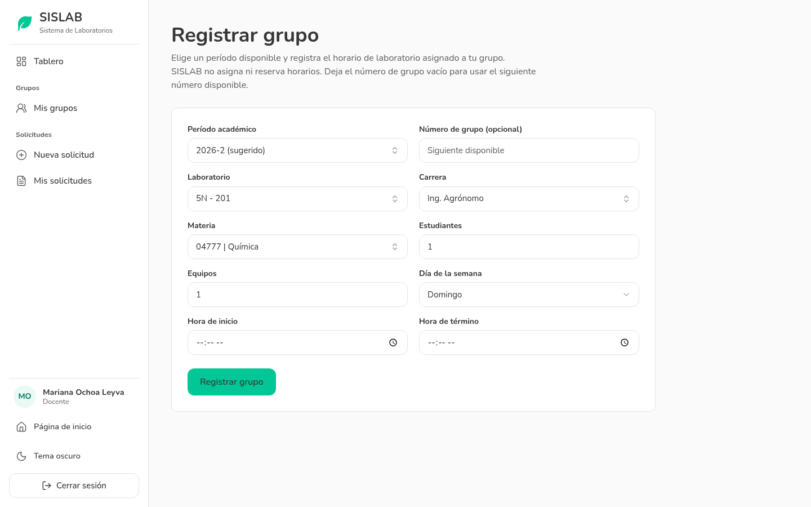

El formulario pide estos datos:

- **Período académico**. SISLAB sugiere el período actual cuando existe en la lista.
- **Número de grupo**. Déjalo vacío para que SISLAB asigne el siguiente número disponible. Ese número es tuyo dentro del período y no cambia aunque desactives el grupo.
- **Laboratorio**, **Carrera** y **Materia**. Son listas de los catálogos que administra SISLAB.
- **Estudiantes** y **Equipos**. Un grupo tiene entre 1 y 60 estudiantes, y el número de equipos no puede superar el número de estudiantes.
- **Día de la semana**, **Hora de inicio** y **Hora de término**.

Completa el formulario y pulsa **Registrar grupo**.

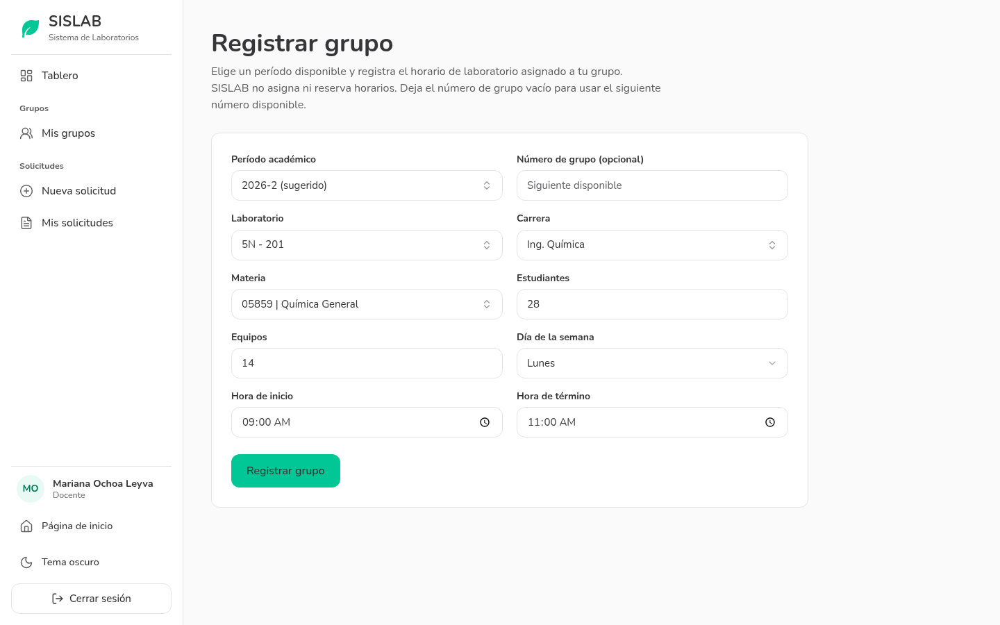

Cuando el registro termina, SISLAB muestra el número del grupo y el período en el que se registró. El formulario queda listo para el siguiente grupo.

SISLAB no reserva horarios. Si el laboratorio ya tiene otro grupo activo en el mismo período, día y horario, SISLAB rechaza el registro con el mensaje "Este laboratorio ya tiene un grupo en ese período y horario. Elige otro horario, día o laboratorio."

**Mis grupos** muestra tu semana en el laboratorio y la lista de tus grupos.

La semana va de domingo a sábado. Las sesiones que ya pasaron aparecen en gris, sin color, las próximas conservan su color y la sesión en curso tiene un contorno que pulsa suavemente. SISLAB actualiza esto cada 30 segundos con la fecha y la hora del laboratorio.

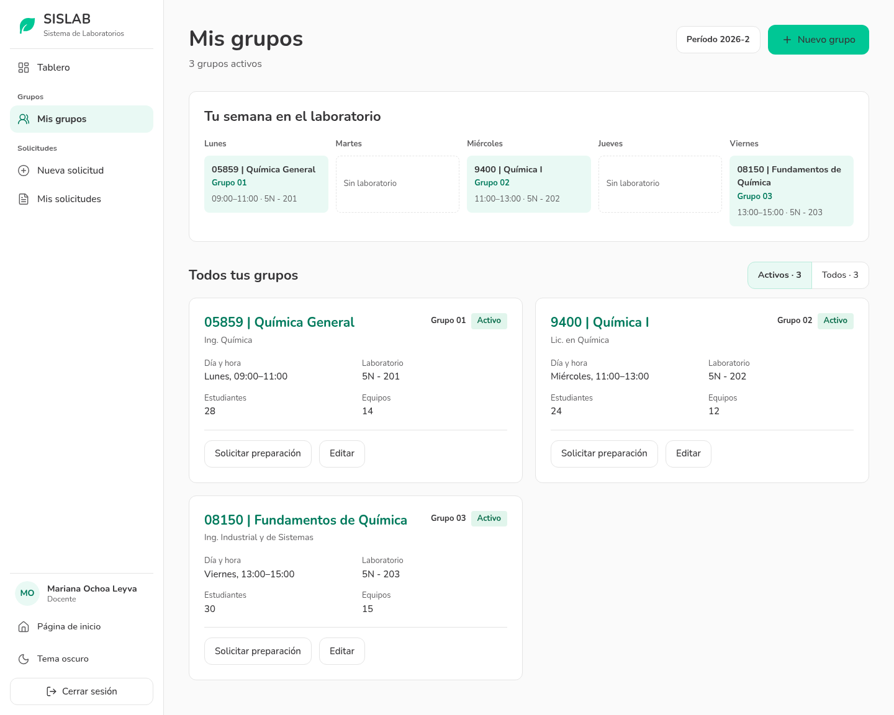

Cada grupo ofrece tres acciones:

- **Solicitar preparación** abre el formulario de solicitud con ese grupo ya seleccionado. Solo aparece en grupos activos.
- **Editar** abre el formulario del grupo con sus datos. Guarda los cambios con **Guardar cambios**.
- **Desactivar** deja de ofrecer el grupo para nuevas solicitudes. Usa **Reactivar** para volver a ofrecerlo. Un grupo inactivo conserva sus solicitudes anteriores.

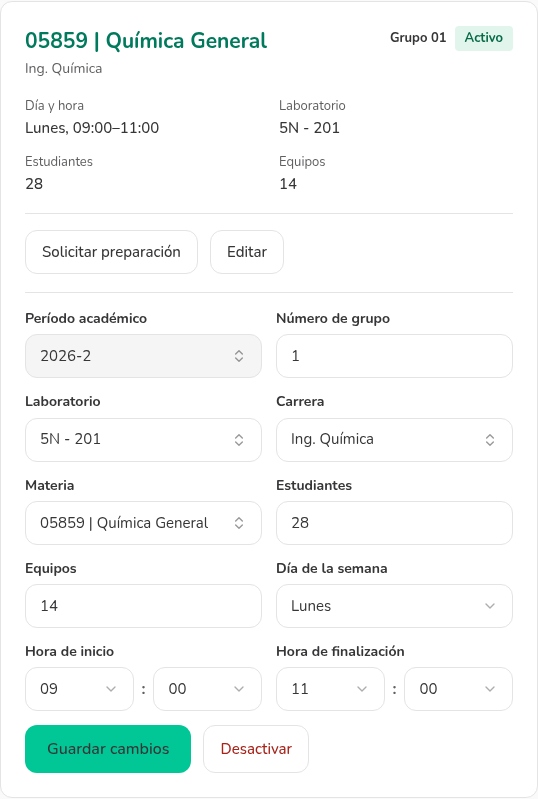

Para ver los grupos inactivos, cambia el filtro **Activos** por **Todos**.

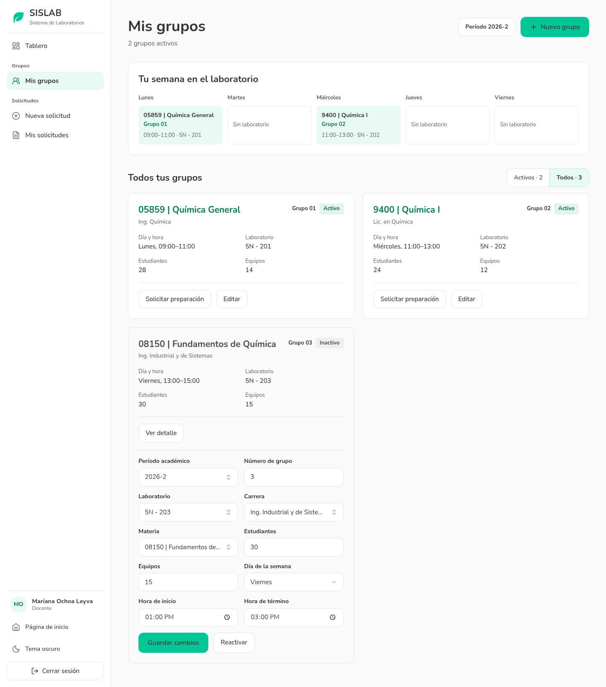

### Creación de solicitudes

Una solicitud pide al personal de laboratorio que prepare los reactivos, el equipo y el manejo de residuos de una práctica para uno de tus grupos. Puedes abrir el formulario desde el menú lateral, con **Nueva solicitud** en el Tablero o con **Solicitar preparación** en un grupo.

El formulario tiene cuatro pasos.

1. **Elige el grupo.** Solo aparecen tus grupos activos.
2. **Elige la fecha.** SISLAB ofrece las tres fechas próximas del día de tu grupo. Si necesitas otra fecha, usa **Elegir otra fecha** para abrir el calendario. El calendario solo permite el día de la semana del grupo, hasta 365 días a futuro.
3. **Elige la práctica.** Busca por número o por nombre en la lista de prácticas activas.
4. **Revisa el material.** Viene prellenado con los reactivos, el equipo y los residuos de la práctica.

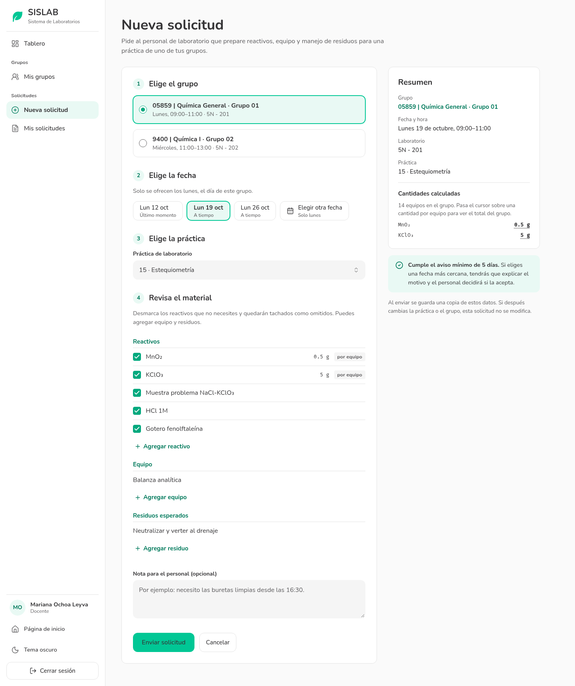

En el paso 4 puedes ajustar el material:

- Desmarca un reactivo que no necesitas. Queda tachado y con la etiqueta **Omitido**.
- Agrega reactivos, equipo o residuos con **Agregar reactivo**, **Agregar equipo** o **Agregar residuo**.
- Escribe una nota para el personal si lo necesitas.

El resumen de la derecha muestra las cantidades calculadas. Son cantidades por equipo multiplicadas por el número de equipos del grupo.

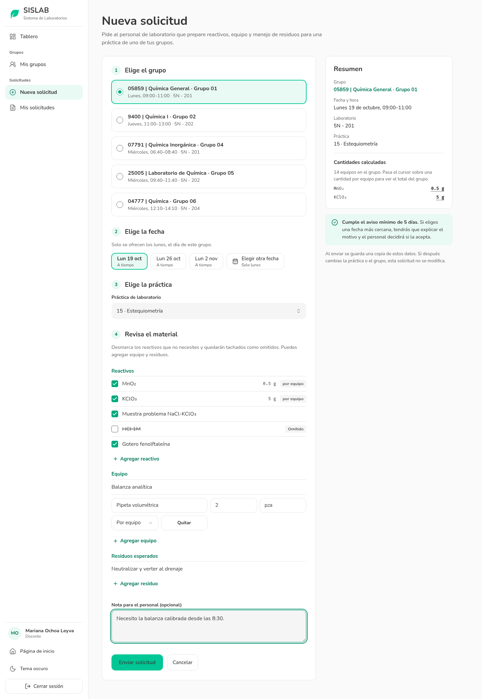

Pulsa **Enviar solicitud**. SISLAB te lleva a **Mis solicitudes**.

#### Dónde encontrar tus solicitudes

**Mis solicitudes**, en la sección **Solicitudes** del menú lateral, lista todas tus solicitudes del período. El filtro **Estado** muestra solo las que tienen un estado concreto. Pulsa **Ver** en una fila para desplegar el detalle, que incluye la fecha de envío, tu nota, los materiales, los reactivos omitidos, los materiales añadidos, los residuos y el motivo de la excepción si existe.

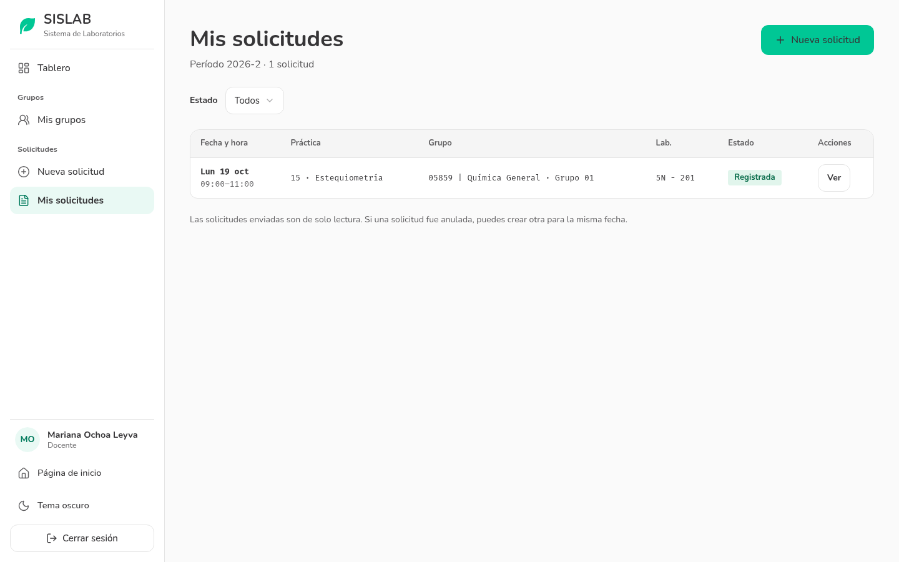

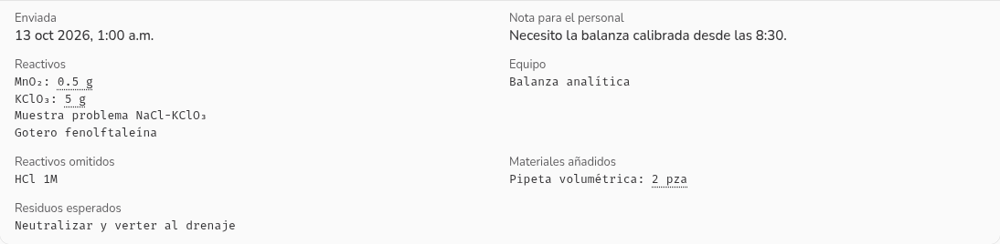

Las solicitudes enviadas no se pueden editar. Si cambias el grupo o la práctica después, la solicitud conserva lo que enviaste. Si necesitas corregir algo, pide al personal de laboratorio que anule la solicitud y crea una nueva.

Los estados posibles son estos:

- **Registrada**. La solicitud está en firme y el personal la preparará.
- **Excepción pendiente**. La solicitud tiene aviso corto y el personal aún no decide.
- **Excepción aceptada**. El personal aceptó el aviso corto. La solicitud entra en el ticket del día.
- **Excepción rechazada**. El personal no aceptó el aviso corto.
- **Anulada**. El personal anuló la solicitud por un error. La fecha queda libre para una nueva solicitud.

#### Aviso corto

Cada práctica necesita un aviso mínimo, que configura la administración en [Configuración](#configuración). El valor de ejemplo de este manual es de 5 días. Si la fecha que eliges llega antes de ese plazo, la solicitud es una **excepción de aviso corto**.

En el formulario, la fecha aparece con la etiqueta **Último momento** en lugar de **A tiempo**. Al elegirla, SISLAB pide el campo **Motivo del aviso corto**, que es obligatorio. El resumen muestra la advertencia "Menos de 5 días de aviso. Explica el motivo."

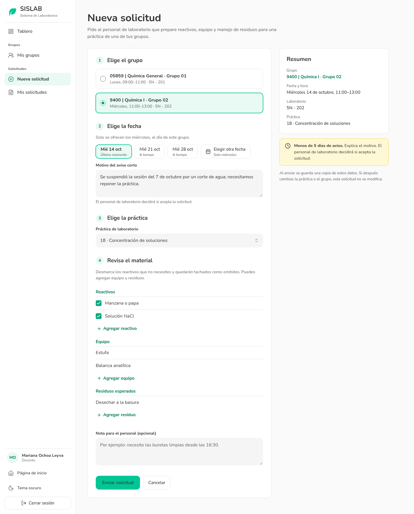

Después de enviar la solicitud, su estado es **Excepción pendiente**. El personal de laboratorio decide si la acepta o la rechaza. Mientras la decisión esté pendiente, la solicitud no aparece en el ticket del día. Cuando el personal la acepta, aparece en el ticket.

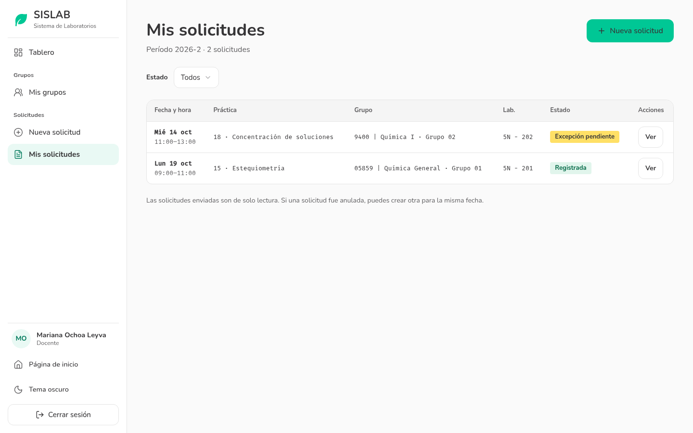

La fecha de una solicitud queda ocupada hasta que la solicitud se anula. Si una excepción se rechaza, no puedes pedir otra solicitud para el mismo grupo y fecha sin que el personal la anule antes.

## Flujos de uso: personal de laboratorio

El personal de laboratorio prepara las prácticas con el ticket diario. Para eso revisa las solicitudes de todos los profesores, decide las excepciones de aviso corto e imprime el ticket.

### Solicitudes

Las solicitudes de todos los profesores están en **Todas las solicitudes**, en la sección **Laboratorio** del menú lateral. El Tablero del personal también muestra las solicitudes de los próximos siete días, con un enlace a la vista completa.

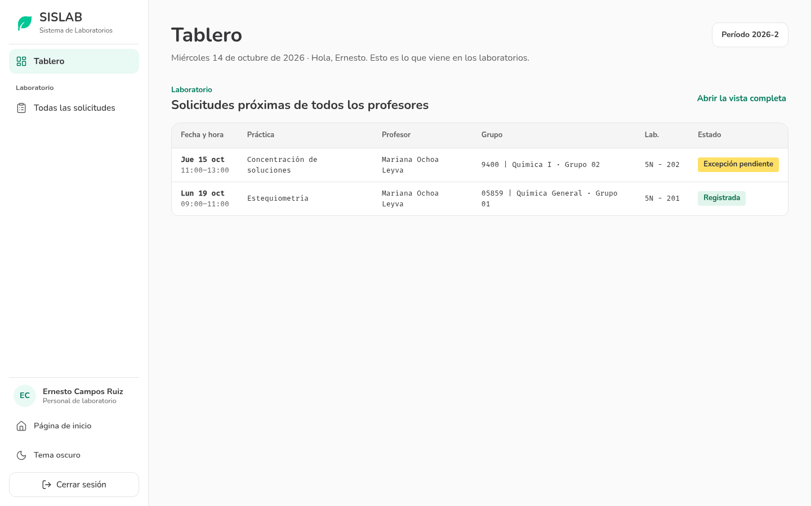

#### Ver la lista de solicitudes

La vista **Todas las solicitudes** comienza con la semana actual.

- **Día** y **Semana** cambian el alcance de la lista.
- Las flechas avanzan o retroceden un día o una semana.
- El selector de fecha muestra un punto en los días con solicitudes.
- **Laboratorio** y **Estado** filtran la lista.
- Cada día de la semana muestra cuántas solicitudes tiene y cuántas están por decidir o sin efecto. Pulsar un día lo selecciona.

Si hay excepciones sin decidir, un aviso amarillo indica cuántas son.

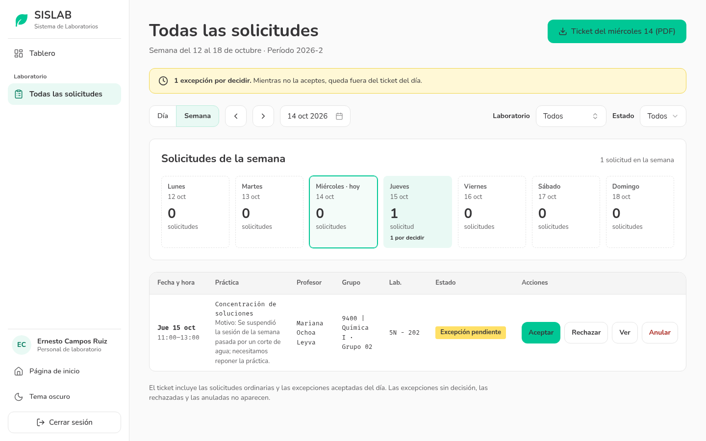

#### Ver el detalle de una solicitud

Pulsa **Ver** en la fila de la solicitud. El detalle se despliega debajo y muestra los materiales, los reactivos omitidos, los materiales añadidos, los residuos esperados y el motivo de la excepción.

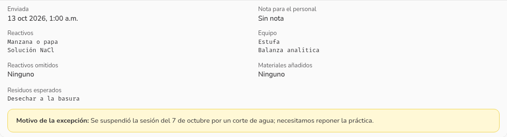

#### Aceptar o rechazar una excepción

Las solicitudes con aviso corto muestran los botones **Aceptar** y **Rechazar** en su fila. Solo aparecen cuando la excepción está pendiente.

- **Aceptar** marca la excepción como aceptada. La solicitud entra en el ticket de su fecha.
- **Rechazar** marca la excepción como rechazada. La solicitud queda fuera del ticket.

Después de aceptar, la fila muestra el estado **Excepción aceptada**.

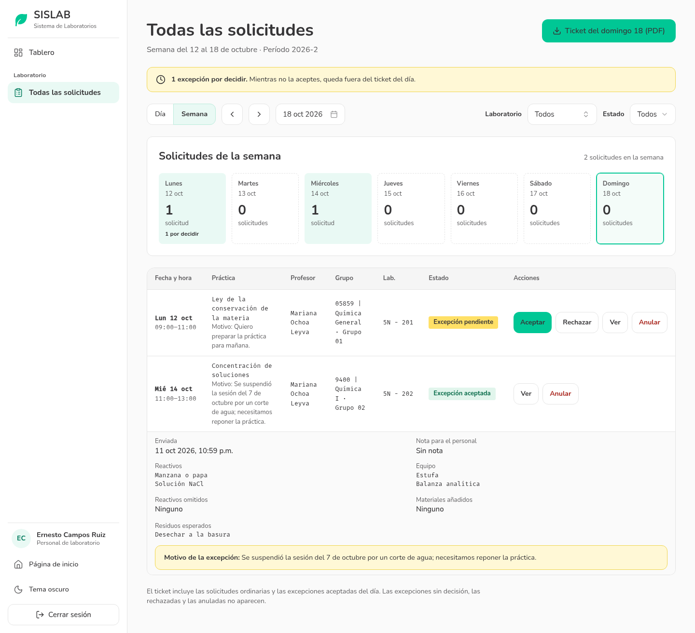

#### Anular una solicitud

Usa **Anular** cuando una solicitud se envió por error. SISLAB pide el motivo en el campo **Motivo de la anulación** y solo activa **Confirmar anulación** cuando lo escribes.

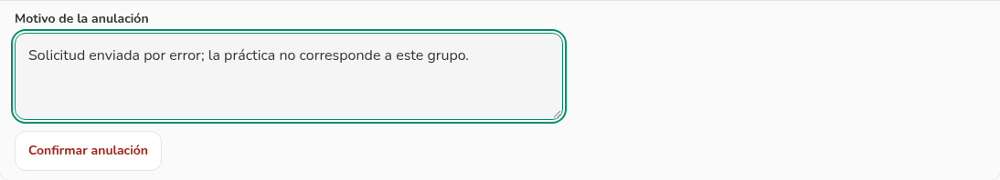

Una solicitud anulada permanece en la lista con el estado **Anulada** y el nombre de quien la anuló. El profesor también la ve en **Mis solicitudes**. La fecha queda libre para que el profesor envíe una solicitud nueva.

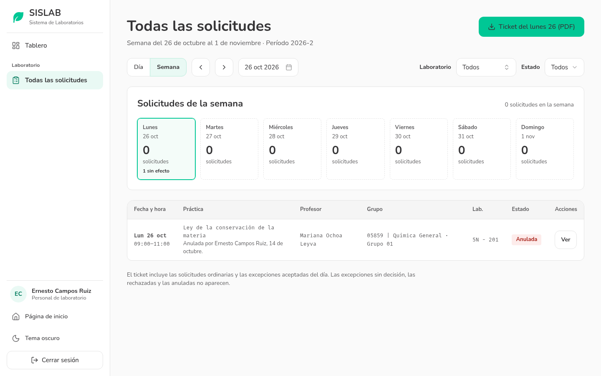

#### Generar el ticket del día

El ticket es el documento impreso que usa el personal para preparar las prácticas. Se genera por día.

1. Elige el día con la lista de la semana o con el selector de fecha. El botón de la parte superior cambia para mostrar ese día.
2. Pulsa **Ticket del [día] (PDF)**. Por ejemplo, **Ticket del miércoles 14 (PDF)**.
3. Revisa el documento en el visor, que incluye herramientas para ampliar, imprimir y descargar.

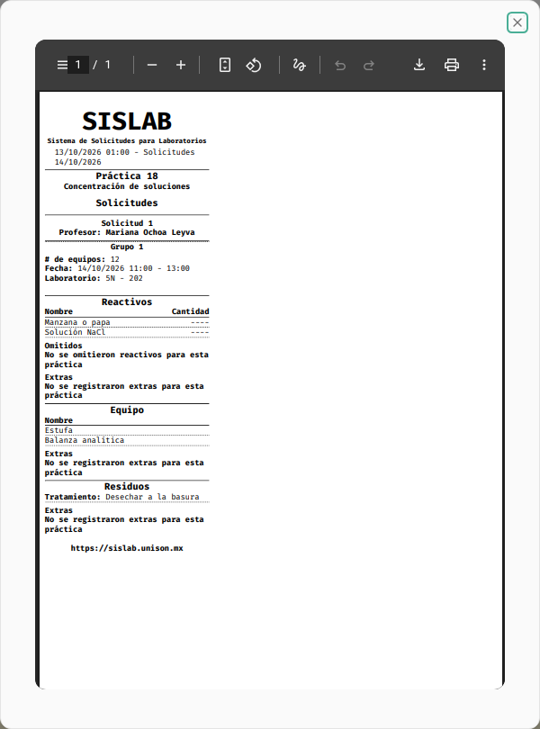

El ticket incluye las solicitudes ordinarias y las excepciones aceptadas de ese día. No incluye las excepciones pendientes, las rechazadas ni las anuladas. Para cada práctica, el ticket muestra el número y el nombre, el grupo, el profesor, el número de equipos, la fecha, el horario, el laboratorio, los reactivos con sus cantidades, los reactivos omitidos, los materiales añadidos, el equipo y el tratamiento de los residuos.

## Flujos de uso: administradores

Un administrador tiene todos los permisos del personal de laboratorio. Ve las mismas solicitudes, decide las mismas excepciones, anula solicitudes y genera el mismo ticket. Además administra las cuentas, las prácticas, los períodos, los catálogos y la configuración.

El menú lateral de un administrador muestra la sección **Administración**, con **Todas las solicitudes** y las secciones de administración.

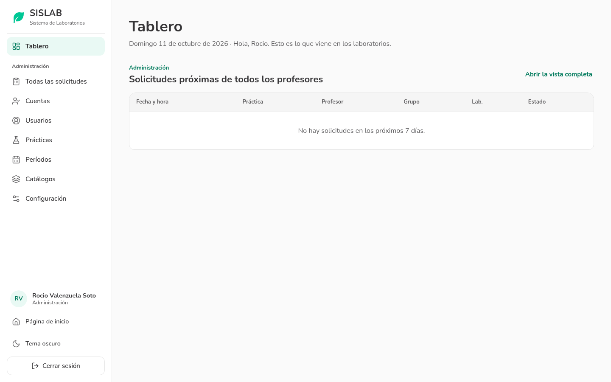

Un administrador no es profesor de forma automática. Si esa persona también debe registrar grupos, otra persona administradora le asigna el rol Profesor en [Asignar y cambiar roles](#asignar-y-cambiar-roles).

### Administración de usuarios

La sección **Usuarios** tiene dos pestañas. La pestaña **Usuarios** lista las cuentas activas y permite cambiar roles, restablecer contraseñas y desactivar cuentas. La pestaña **Solicitudes de acceso** lista a las personas que pidieron acceso y esperan su activación.

#### Ver las solicitudes de acceso

Cada persona que pide acceso aparece en la pestaña **Solicitudes de acceso**. El número de solicitudes pendientes aparece también en el menú lateral, junto a **Usuarios**, como una insignia amarilla. La insignia y el número de la pestaña muestran cuántas solicitudes esperan una decisión.

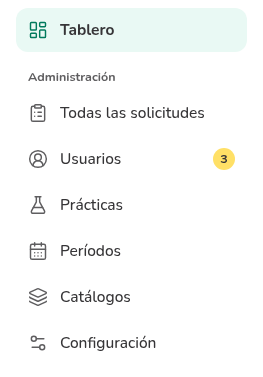

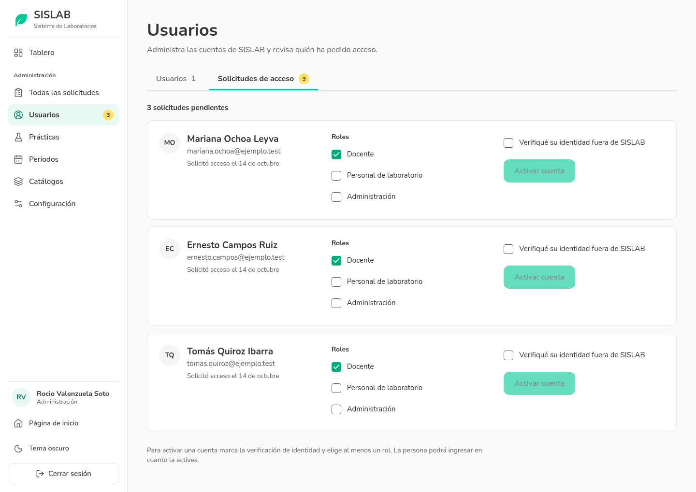

#### Activar una cuenta nueva

Abre la pestaña **Solicitudes de acceso**. Antes de activar una cuenta, verifica la identidad de la persona fuera de SISLAB. SISLAB no tiene una forma de hacerlo.

Para activar una cuenta:

1. Marca la casilla **Verifiqué su identidad fuera de SISLAB**.
2. Elige al menos un rol: **Profesor**, **Personal de laboratorio** o **Administración**. El rol Profesor viene marcado por defecto.
3. Pulsa **Activar cuenta**.

Los botones se habilitan cuando marcas la verificación y eliges al menos un rol. La cuenta queda activa de inmediato.

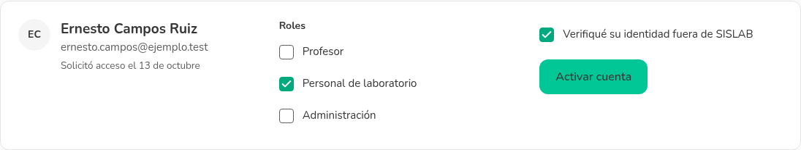

Cuando la cuenta se activa, SISLAB muestra el aviso "[Nombre] ya puede ingresar a SISLAB." y la solicitud sale de la lista. La persona aparece ahora en la pestaña **Usuarios**, y la insignia baja en uno.

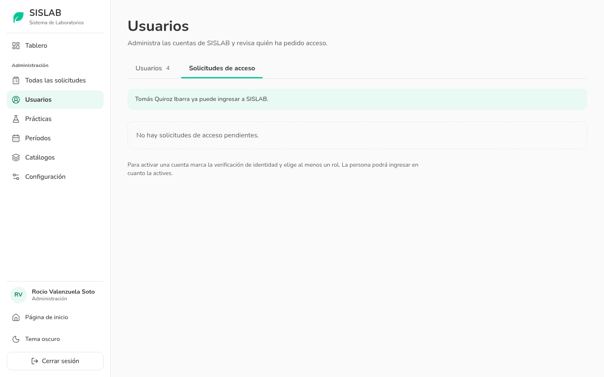

Cuando no quedan solicitudes pendientes, la insignia desaparece del menú lateral.

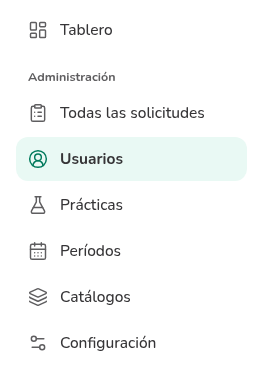

#### Buscar y seleccionar una cuenta

La pestaña **Usuarios** lista las cuentas activas. Escribe en el campo **Buscar** para filtrar por nombre o correo, o usa el filtro **Rol**. Pulsa el nombre de una persona para ver su tarjeta con roles y estado.

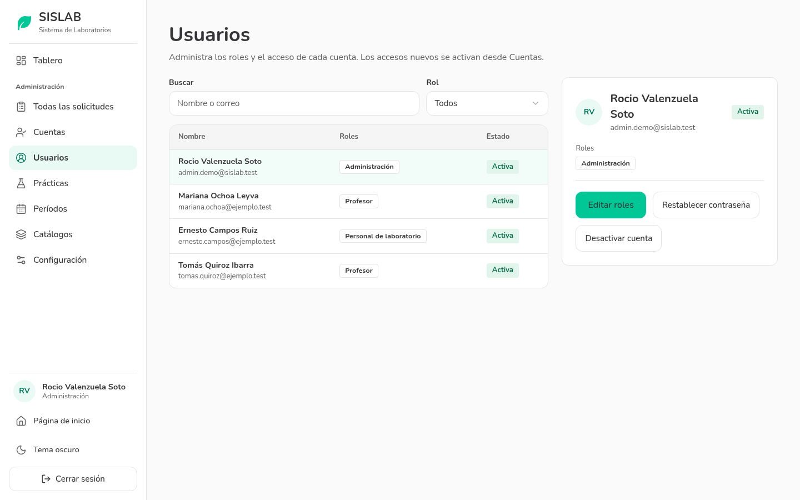

#### Asignar y cambiar roles

Con la cuenta seleccionada, pulsa **Editar roles**. Marca o desmarca **Profesor**, **Personal de laboratorio** o **Administración**, y pulsa **Guardar roles**.

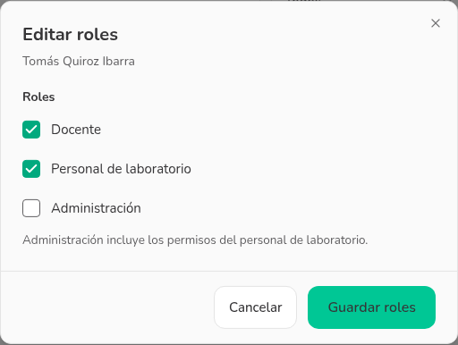

El rol Administración incluye los permisos del personal de laboratorio, así que no hace falta marcar también Personal de laboratorio. Un usuario puede tener varios roles, por ejemplo Profesor y Personal de laboratorio.

#### Restablecer contraseña

Cuando una persona no puede ingresar porque olvidó su contraseña, pulsa **Restablecer contraseña** en la tarjeta de la cuenta. Escribe la contraseña nueva en el campo **Contraseña nueva**, de al menos 12 caracteres, y pulsa **Restablecer contraseña** en el diálogo.

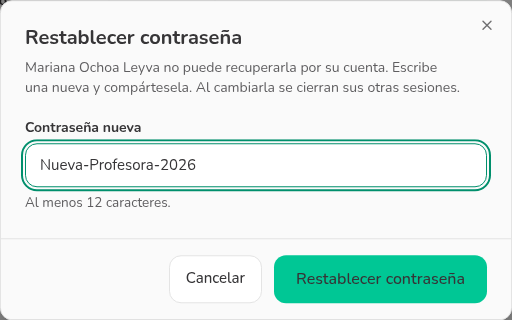

SISLAB cierra las otras sesiones de esa cuenta. Comparte la contraseña nueva con la persona por un medio seguro. La persona no puede recuperarla por su cuenta.

#### Desactivar y reactivar una cuenta

Pulsa **Desactivar cuenta** para impedir que una persona ingrese. La tarjeta muestra el estado **Inactiva**. La persona no puede ingresar, y SISLAB le muestra el mismo mensaje que para una contraseña incorrecta.

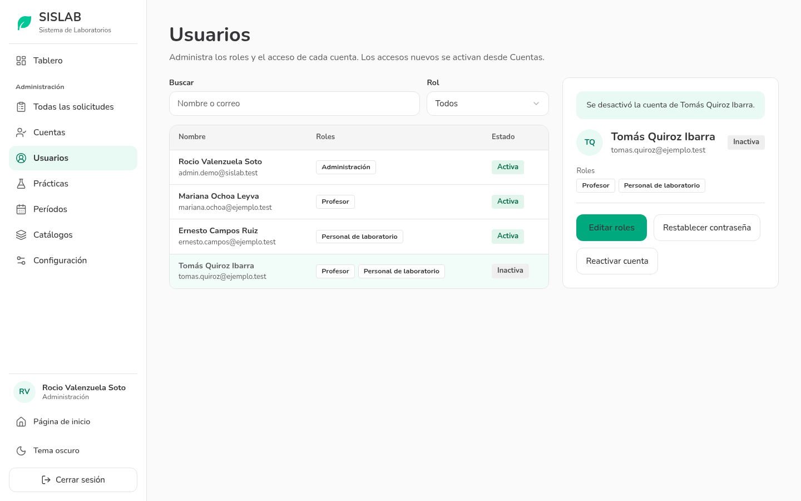

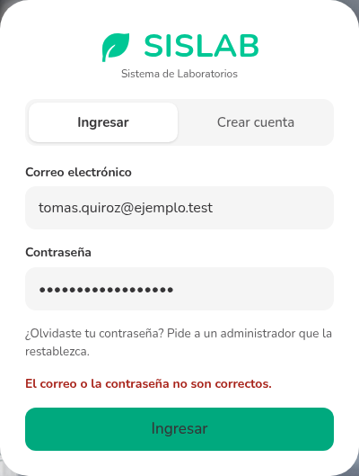

Para permitir el acceso otra vez, selecciona la cuenta y pulsa **Reactivar cuenta**. Solo puedes reactivar cuentas que ya fueron aceptadas. Una persona que todavía espera en **Solicitudes de acceso** se activa desde esa pestaña, porque ahí se confirma su identidad. Un profesor desactivado no vuelve a aparecer en **Solicitudes de acceso**. Desactivar una cuenta no borra sus grupos ni sus solicitudes.

### Prácticas de laboratorio

**Prácticas** es el catálogo de las prácticas que los profesores pueden solicitar. Cada práctica define sus reactivos, su equipo y sus residuos esperados. La lista muestra el número, el nombre, la cantidad de materiales y el estado de cada práctica. Usa **Buscar** para filtrar por número o nombre.

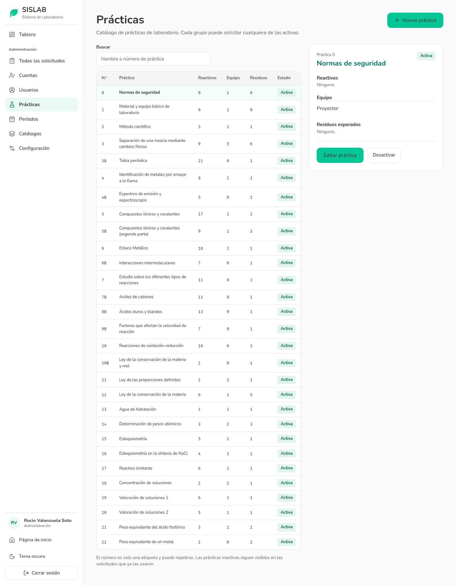

#### Crear una práctica

Pulsa **Nueva práctica**. El diálogo pide estos datos:

- **Número o etiqueta**. Puede repetirse. Puede ser un número o una clave, por ejemplo "12" o "Q-3".
- **Nombre** de la práctica.
- **Reactivos**. Para cada uno escribe el nombre, la cantidad, la unidad y la base. La base puede ser **Por equipo** o **Por grupo**.
- **Equipo**, con los mismos campos.
- **Residuos esperados**. Cada residuo tiene un nombre opcional, un contenedor opcional y un tratamiento obligatorio.

Pulsa **Crear práctica** para guardarla.

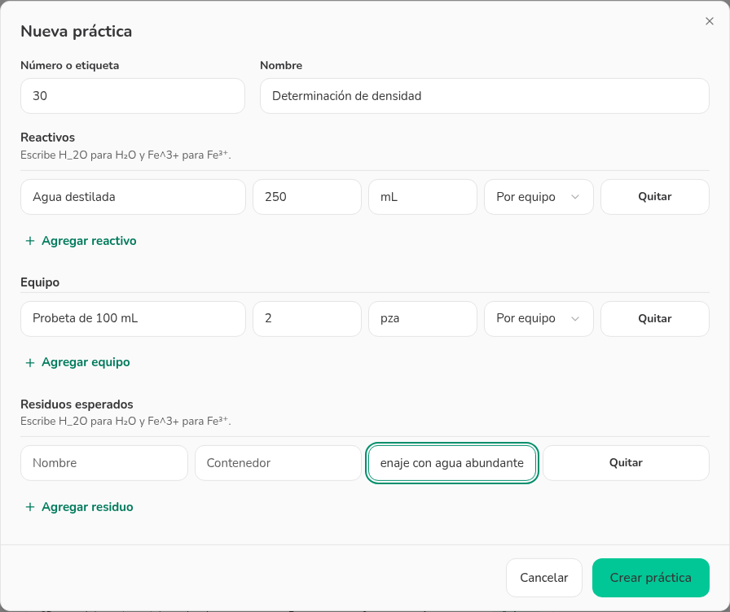

#### Actualizar una práctica

Selecciona la práctica en la lista, pulsa **Editar práctica**, cambia lo que necesites y pulsa **Guardar cambios**. Los cambios aplican a las solicitudes nuevas. Las solicitudes anteriores conservan los materiales con los que se enviaron.

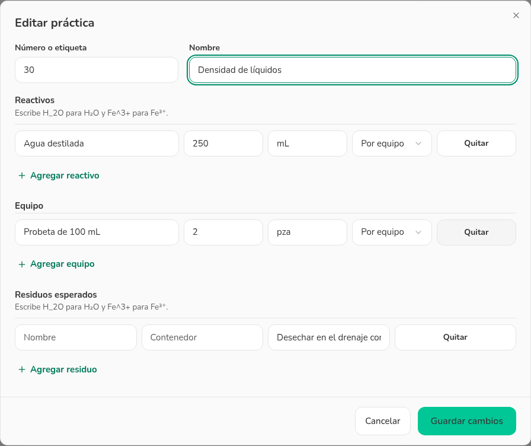

#### Desactivar una práctica

Selecciona la práctica y pulsa **Desactivar**. SISLAB pide confirmación. Una práctica desactivada deja de aparecer para solicitudes nuevas. Sigue visible en las solicitudes que ya la usaron.

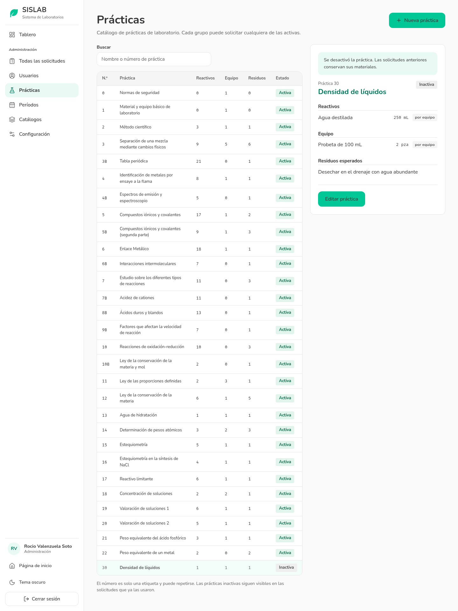

La interfaz no tiene un botón para reactivar una práctica. Antes de desactivarla, confirma que ya no se va a solicitar.

### Períodos

Un período académico es un intervalo de enseñanza identificado con un código. El código tiene el año y el término, por ejemplo **2026-1** o **2026-2**. Los grupos se registran dentro de un período. **Períodos** es la pantalla donde administras esa lista.

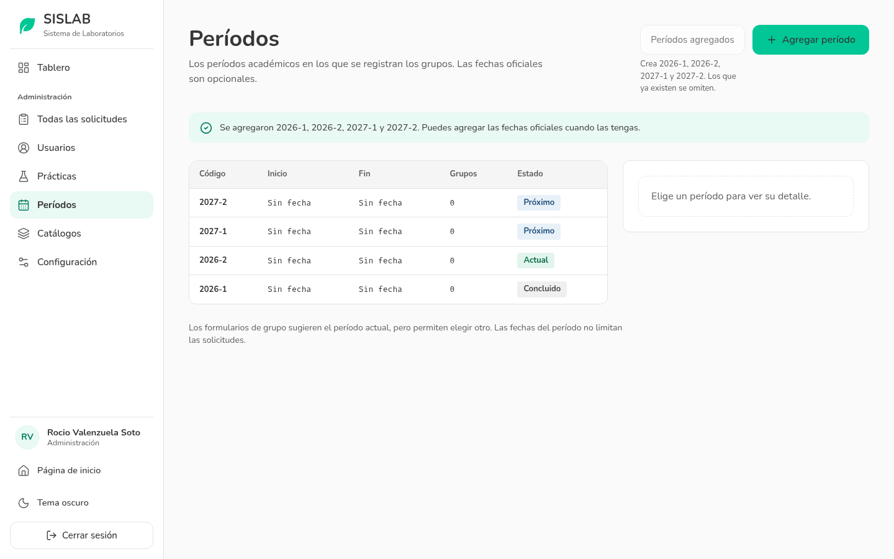

#### Crear períodos

Hay dos formas de crear períodos.

- **Agregar períodos 2026 y 2027** crea los dos términos de cada año. Los que ya existen se omiten.
- **Agregar período** crea uno solo. El código debe tener el formato AAAA-1 o AAAA-2.

Las fechas oficiales de inicio y fin son opcionales. Si las escribes, escribe las dos. La fecha de fin debe ser igual o posterior a la de inicio.

#### Actualizar un período

Selecciona el período en la tabla y pulsa **Editar período**. Escribe o elige las fechas de inicio y de fin, y pulsa **Guardar período**.

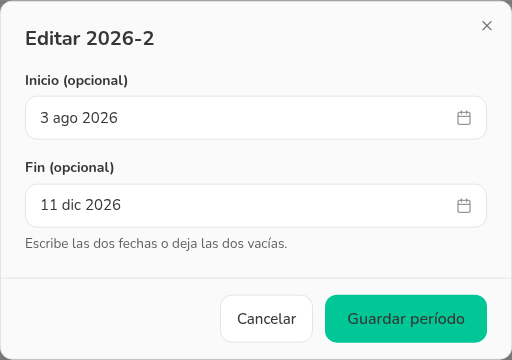

Después de guardar, el período muestra sus fechas en la tabla y en la tarjeta.

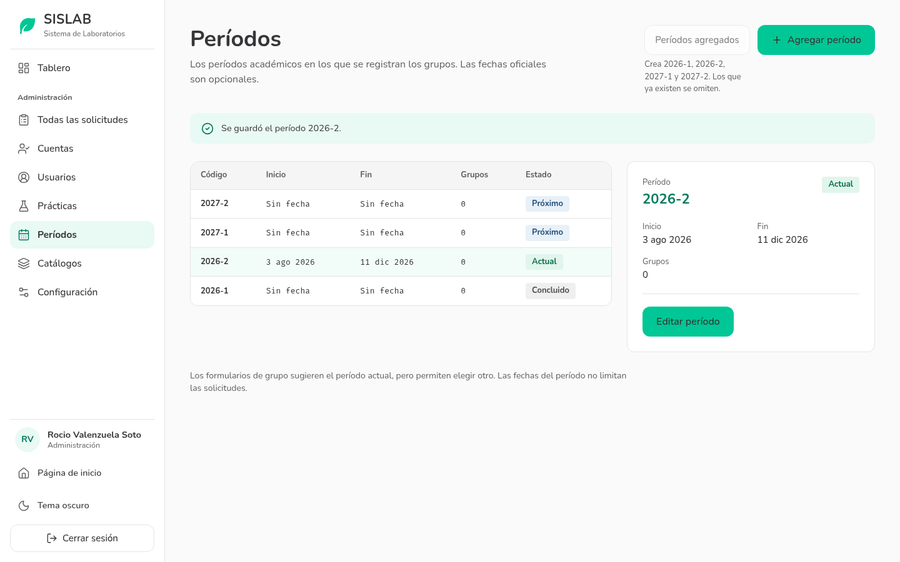

La columna **Estado** indica si el período es **Actual**, **Próximo** o **Concluido** según la fecha de hoy.

#### Por qué mantener los períodos al día

Los profesores solo pueden registrar grupos en los períodos que existen en esta lista.

- El formulario de grupo sugiere el período actual solo si existe. Si falta, el profesor debe elegir otro período o pedirte que lo crees.
- Si no hay períodos, el formulario muestra el aviso "Aún no hay períodos académicos disponibles".
- Crea el período siguiente antes de que los profesores lo necesiten, para que puedan registrar sus grupos a tiempo.

Las fechas oficiales son informativas. No limitan las solicitudes. Un profesor puede pedir una práctica en cualquier fecha que tenga un día válido para su grupo.

### Catálogos

Los catálogos son las listas que se usan al registrar grupos: **Laboratorios**, **Carreras** y **Materias**. La pantalla **Catálogos** muestra una tarjeta con el número de elementos de cada lista.

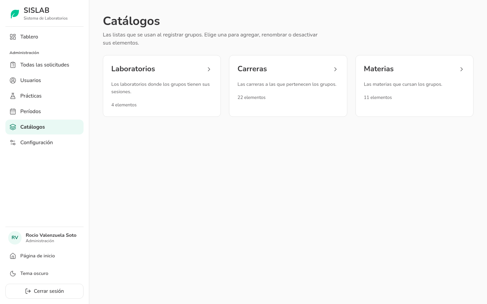

Pulsa una tarjeta para abrir su lista.

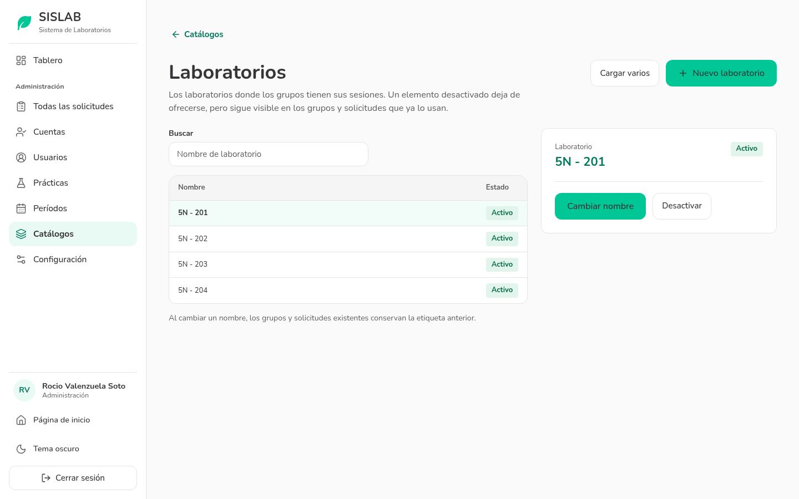

#### Agregar elementos

Pulsa el botón de creación de la lista, por ejemplo **Nuevo laboratorio**, escribe el nombre y pulsa **Crear laboratorio**. Los botones dicen **Nueva carrera** o **Nueva materia** en esas listas.

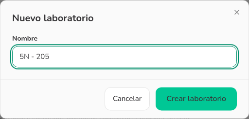

Para agregar varios elementos a la vez, usa **Cargar varios**. Escribe un valor por línea. Los que ya existen se omiten.

#### Cambiar un nombre

Selecciona el elemento y pulsa **Cambiar nombre**. Los grupos y las solicitudes existentes conservan el nombre anterior. Solo los grupos nuevos usan el nombre actualizado.

#### Desactivar un elemento

Selecciona el elemento y pulsa **Desactivar**. El elemento deja de ofrecerse al registrar grupos nuevos, pero sigue visible en los grupos y solicitudes que ya lo usan. Usa **Reactivar** para ofrecerlo otra vez.

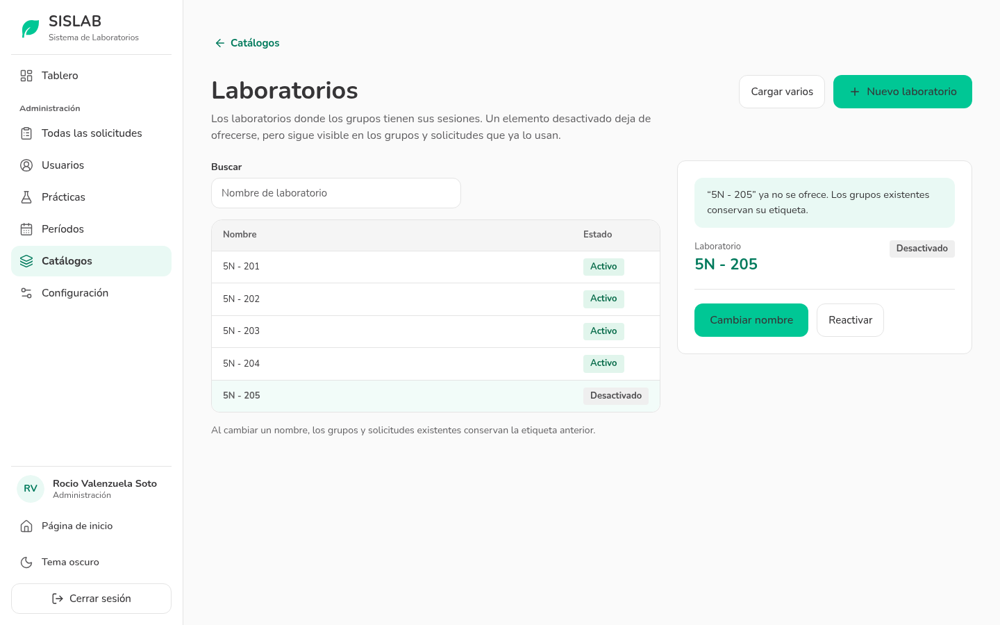

### Configuración

**Configuración** define el aviso mínimo para las solicitudes. Es el número de días de calendario que deben pasar entre el envío de una solicitud y la fecha de la práctica. Con menos días, el profesor debe escribir el motivo y el personal decide si acepta la solicitud.

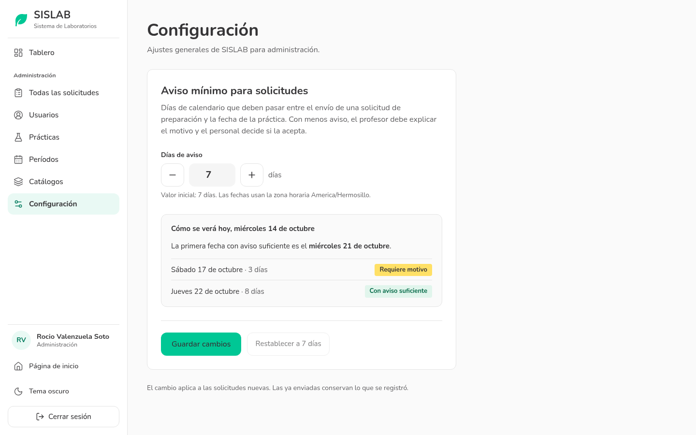

Para cambiar el aviso mínimo:

1. Usa los botones **Restar un día** y **Sumar un día**, o escribe el número en el campo **Días de aviso**. El valor va de 0 a 60 días.
2. Revisa la vista previa **Cómo se verá hoy**. Muestra cuál es la primera fecha con aviso suficiente y ejemplos de fechas con y sin aviso.
3. Pulsa **Guardar cambios**.

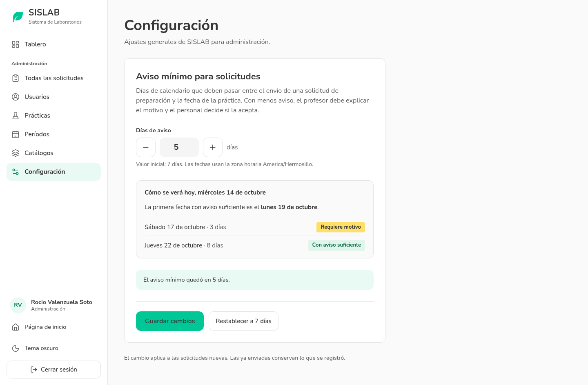

El valor inicial es de 7 días. **Restablecer a 7 días** vuelve a ese valor. El cambio aplica a las solicitudes nuevas. Las solicitudes ya enviadas conservan lo que se registró al enviarlas. Las fechas usan la zona horaria de Hermosillo.
